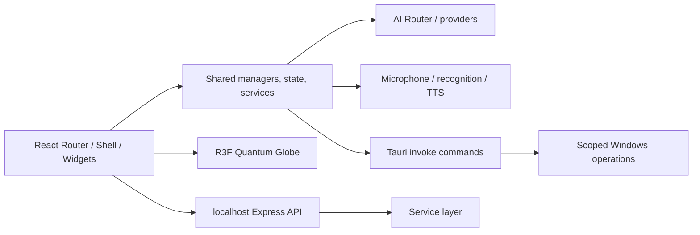
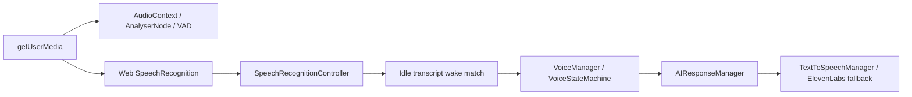

# JARVIS OS System Capability Audit v1.0

**Audit date:** 2026-07-26  
**Scope:** `apps/`, `services/`, `packages/`, and `tools/`, excluding generated dependencies and build output. 808 source/support files were inventoried.  
**Method:** source inspection only. Claims marked **Unable to Verify** require a built application, configured credentials, or operating-system/device access. “Exists” means source code was found; it does not prove production deployment.

## 1. Executive summary

JARVIS OS is a feature-rich TypeScript React/Tauri desktop-assistant codebase with a real UI, local persistence, multi-provider AI abstraction, voice pipeline, ambient audio, globe renderer, settings, and a limited native Windows command surface. Its maturity is uneven: core interaction/UI systems are materially implemented; many advertised autonomous, browser, coding, automation, agent, and backend integrations are partial or explicitly simulated.

| Assessment | Result |
|---|---|
| Overall maturity | **Prototype / early integration product** |
| Architecture quality | **6/10** — clear domain folders and singleton managers, but a large client-side service graph, duplicate desktop shells, and many mock boundaries |
| Verified implementation completion | **~48%** of the stated assistant platform scope |
| Readiness | Suitable for controlled iterative development; not ready to claim broad autonomous-desktop capability |

**Strengths:** React/Tauri foundation; meaningful AI provider routing; persistence shim; visual dashboard; Web Audio/voice/TTS components; scoped native filesystem actions; explicit UI state machines.

**Weaknesses:** no verified authentication boundary on Express; mock agent/browser/automation integrations; no durable database/vector store; no WebSocket/MCP server; Electron shell opens `about:blank`; limited automated test orchestration; architectural duplication.

**Top risks:** backend `execute-command` route exposes command execution without visible authentication; client-build-time `VITE_*` secret usage; in-memory/simulated capabilities presented through broad manager interfaces; browser speech recognition depends on the WebView implementation.

## 2. Project structure

```text
jarvis/
├─ apps/
│  ├─ web/                 React 18 + Vite + R3F + Tauri frontend
│  │  └─ src/{app,entities,features,shared,widgets,pages}
│  └─ desktop/             Separate Electron shell (loads about:blank)
├─ services/backend/       Express API and service-layer stubs/adapters
├─ packages/               Present in workspace configuration; no audited package source found
├─ docs/                   Design, architecture, developer, and knowledge documents
└─ tools/                  Present; no substantive source inventory found
```

The frontend uses domain entities (`ai-core`, `automation`, `browser`, `coding`, `crm`, `financial`, `globe`, `memory`, `trading`), cross-cutting shared managers, widgets, and one dashboard route. Source evidence: `apps/web/src/app`, `apps/web/src/entities`, `apps/web/src/shared`, `apps/web/src/widgets`.



## 3. Boot process

Verified startup path from `apps/web/src/app/main.tsx`:

```text
Module evaluation → initLocalStorageShim() → DisplaySettings.hydrate()
→ bootstrap() → customProviderManager.reloadFromStorage()
→ conversation persistence subscription → React root/AppRouter
→ Shell → persistent voice controllers + workspace route
→ HomeWorkspace → AICore → Quantum Globe Canvas
```

`bootstrap()` evaluates financial, CRM, automation, browser, coding, and audio managers; registers a memory-compression summarizer; starts ambient audio (`apps/web/src/app/bootstrap.ts`). The persistent Shell mounts `SpeechRecognitionController` and an R3F Canvas hosting `MicrophoneController` (`apps/web/src/pages/dashboard/ui/Shell.tsx`). The default route mounts the dashboard/globe. AI does not make a request at boot. Idle is the default voice state.

**Unable to Verify:** actual startup success, Tauri launch, operating-system permission outcome, and native WebView speech support from source alone.

## 4. AI system

| Capability | Evidence | Status | Score |
|---|---|---:|---:|
| Provider routing/model choice | `shared/ai/AIRouter.ts`, `ProviderModelMapper.ts` | Partial | 7 |
| Providers | Gemini, OpenAI-compatible, Claude, NVIDIA, Ollama, Local providers | Partial; credentials/service-dependent | 7 |
| Fallback/health ordering | `AIRouter.ts`, `AIProviderHealthManager.ts` | Partial | 7 |
| Response streaming | Provider `generateStream`; `AIResponseManager.ts` | Partial | 7 |
| Retry/backoff | `RetryManager.ts` | Implemented | 7 |
| In-flight stream deduplication | `AIRouter.ts` stream request keys | Implemented | 6 |
| Request queueing | AIRouter execution queue | Partial | 5 |
| Rate limiting | Error/health classification only; no shared limiter found | Partial | 3 |
| Prompt construction | `PromptBuilder.ts`, identity directives | Partial | 6 |
| Conversation history | `ConversationManager.ts` | Implemented, local persistence | 6 |
| Memory context injection | `MemoryContextBuilder.ts`, financial/CRM/coding writes | Partial | 5 |
| Tool/function calling | Prompt contains tool JSON; agent orchestration exists | Prototype; no provider-native tool loop verified | 3 |

The UI response path is `AIResponseManager.respond()` → agent orchestrator first → `AIRouter.generateResponse()` with streaming chunks queued to TTS. The Express `/api/ai/chat` endpoint calls `BrainService.complete`, but the frontend also calls providers directly. This creates two AI execution paths.

## 5. Voice system



| Capability | Status | Notes |
|---|---|---|
| Microphone permission / stream reuse | Partial | `MicrophoneManager.ts` uses `getUserMedia`, creates analyser, reuses live stream |
| VAD | Partial | RMS/noise threshold in `MicrophoneManager.update()`; called per R3F frame |
| Recognition | Partial | Web Speech API, continuous/interim configuration, restart logic; WebView support is external |
| Wake-word matching | Partial | `SpeechRecognitionController.tsx` matches `hey jarvis`/`jarvis`; `WakeWordEngine.ts` exists but is not imported elsewhere |
| Idle lifecycle | Implemented | persistent controllers and idle-silence fix in `VoiceManager.ts` |
| TTS | Partial | browser synthesis queue and ElevenLabs provider/fallback |
| Interrupt/barge-in | Partial | `InterruptManager.ts`, recognition result handling during speaking |
| Voice state machine | Implemented | `VoiceStateMachine.ts` watchdog and states |
| Audio routing | Partial | browser audio + ambient mixer; no native input/output routing abstraction found |

**Important:** actual wake recognition is **Unable to Verify** without the target WebView and microphone. The source is wired to keep passive recognition alive during IDLE silence.

## 6. Memory system

| Feature | Status | Evidence |
|---|---|---|
| Working / short-term memory | Implemented | `WorkingMemory.ts`, `ShortTermMemory.ts` |
| Long-term memory | Partial | `LongTermMemory.ts`, local providers |
| Persistence | Partial | localStorage provider and Tauri storage shim |
| Conversation history | Implemented | `ConversationManager.ts` + local export/import |
| Ranking/search | Partial | `MemoryRanking.ts`, `MemorySearch.ts` |
| Compression | Partial | `MemoryCompression.ts`; summarizer registered at bootstrap |
| Context builder/injection | Partial | `MemoryContextBuilder.ts` |
| Embeddings/vector database | Not Found | no embedding model, vector DB client, or remote vector service found |
| Semantic search/knowledge graph | Not Found | keyword/local record search only; backend “vectorDocuments” is an in-memory text array |
| Expiration | Partial | memory types/routing support; durable expiry enforcement not verified |
| User profile/preferences | Partial | identity and settings are persisted locally |

## 7. Agent system

`shared/agents` contains `AgentOrchestrator`, router, context, tool manager, safety modules, and implementations for Automation, Browser, Calling, CRM, Coding, Document, Email, Financial, Insurance, Investment, Knowledge, Meta, Research, Supervisor, Terminal, Trading, and WhatsApp.

Most classes are dispatch/response frameworks rather than verified real integrations. Explicit mock/simulation markers appear in `ToolManager.ts`, `EmailAgent.ts`, `AutomationAgent.ts`, `DocumentAgent.ts`, `WhatsAppAgent.ts`, and the coding/browser entities. `MetaAgent` can synthesize generated agent source text, but dynamic production loading/sandboxing is not verified.

| Agent class | Status |
|---|---|
| Orchestrator/supervisor/meta | Partial |
| Coding, Browser, Terminal | Prototype / simulated or constrained capability |
| Finance, Trading, CRM | Partial; domain-manager-backed where available |
| Calling, WhatsApp, Email | Prototype; credential/config dependent or mock |
| Vision agent / planner agent | Not Found as dedicated implementations |

## 8. Automation system

`entities/automation` implements workflow records, triggers, conditions, action services, queue, worker, cron parsing, webhook interface, and `AutomationManager`. Cron evaluation is client-side `setInterval`; the worker is in-process. Notification/email/WhatsApp/SMS service adapters default to mock providers (`services.ts`).

| Capability | Status |
|---|---|
| Workflow engine, conditions, templates, queue | Partial |
| Cron / scheduled triggers | Partial, in-process only |
| Webhook interface | Partial; external POST is mocked |
| Background worker | Partial; browser-process interval, not durable worker |
| Email / WhatsApp / SMS | Prototype; mock providers |
| Calendar integration | Not Found |
| Persistent job scheduler / retries | Not Found |

## 9. Computer control

| Capability | Status | Evidence |
|---|---|---|
| Launch named apps | Partial | Tauri: Chrome, VS Code, Spotify only |
| Open folders/create folders | Partial | scoped `KnownFolder` commands |
| Filesystem read/write/organize/rename | Partial | Tauri allowlisted user folders; backend also exposes write route |
| Screenshot | Partial | Tauri `take_screenshot` |
| System volume | Partial | Tauri Windows Core Audio calls |
| Clipboard | Partial | Tauri clipboard plugin permission |
| Web search/open browser | Partial | named URL/search commands |
| Close/move/resize windows | Not Found | no matching native command found |
| Keyboard/mouse/accessibility/OCR/camera | Not Found |
| Terminal control | Partial / high risk | Express command endpoint; dedicated Electron shell is blank |
| Registry, task manager, power controls | Not Found |

## 10. Browser system

`entities/browser` contains `BrowserAgentManager`, `SearchEngine`, `DocumentReader`, and `WebsiteAnalyzer`. Search can fetch/search, but the manager includes configured `mockWebpages`; no browser automation driver, tab control, cookies, profiles, downloads, history, or persistent sessions was found.

**Status:** browser research/summarization is Partial; browser automation is Missing.

## 11. Coding system

`entities/coding` and `CodingWorkspace.tsx` provide project-analysis, search, file-manager, repository, terminal, knowledge, review/explain/generate UI flows. `CodingAgentManager` uses AI and memory. However `config.ts` supplies mock project files; `repository.ts` and `terminal.ts` report mock results. The backend command endpoint exists but is not safely integrated as a verified coding executor.

| Capability | Status |
|---|---|
| Coding UI / code generation / review prompts | Partial |
| Workspace indexing/search | Partial / mock-backed |
| Real file editing | Not Found as verified frontend workflow |
| Git integration | Prototype / mock repository data |
| Terminal execution | Prototype / mock in entity; backend route exists separately |
| Diagnostics/debugging | Partial, UI-level |

## 12. Vision system

Screenshot capture exists in Tauri. PDF text extraction exists in `src-tauri/src/lib.rs`; scanned PDFs return a marker rather than performing OCR. No camera capture, OCR engine, image-understanding provider, object detection, video analysis, or screen-understanding pipeline was found.

## 13. Dashboard

The dashboard is a real React layout with sidebar, topbar, three-column home workspace, settings, chat, finance/CRM/coding workspaces, notifications, display/sidebar settings, audio controls, animations, and R3F globe. Several router paths (`Missions`, `Memory`, `Files`, `Terminal`, `Browser`, `Devices`) intentionally render `ModulePlaceholder`.

Status: **Partial, high visual maturity**. Responsive behavior is CSS-based; cross-device validation is **Unable to Verify**.

## 14. Quantum Globe

`shared/graphics/Globe/QuantumGlobeCanvas.tsx` uses React Three Fiber, shader layers, animation frames, FPS counter, and `QuantumGlobeEngine`. Globe state/mood/audio/music parameters are modeled in `entities/globe/model`. Voice and audio managers push state to `GlobeStateManager`.

The compact status button is in `entities/globe/ui/GlobeStatusButton.tsx`; diagnostics are a click-open right-side sheet. Render performance/FPS quality is **Unable to Verify** without a running GPU target.

## 15. Settings system

Settings UI includes API keys/custom providers, identity/personality, display/theme, sidebar/dashboard customization, audio, voice/provider controls, financial profile, and system context. Persistence uses localStorage plus Tauri storage/backend fallback. No verified account synchronization, privacy center, updater settings, or enterprise policy management was found.

## 16. Plugin system

There are plugin entity/backend service names (`entities/plugin`, `PluginService.js`) and configuration UI references. A complete plugin loader, lifecycle isolation, hot reload, marketplace, package versioning, permission model, or external plugin execution runtime was **Not Found**.

## 17. API system

Express exposes `/api/health`, settings get/save, `system/open-app`, `system/execute-command`, `system/write-file`, provider-key status/validation, and `/api/ai/chat`. Tauri exposes IPC commands for storage, app launching, search, limited filesystem actions, screenshot, volume, PDF/file operations, and API-key saving.

REST exists. WebSocket, SSE endpoint ownership, MCP server, Python bridge, API authentication, API authorization, and backend rate limiting were **Not Found**.

## 18. Backend

`services/backend` is a small Node/Express process with 15 named service files. Most API surface is in `server.js`; only `routes/ai.js` is a route module. Storage is file/local-memory based. Database, cache server, queue broker, worker process, structured production monitoring, and log aggregation were **Not Found**.

The separate `apps/desktop` Electron project is not an alternative functioning JARVIS frontend: it creates a secure Electron window but explicitly loads `about:blank`.

## 19. Security

Positive controls found: Tauri capability manifest limits plugins; Electron uses context isolation, disabled Node integration, and sandboxing; Tauri `KnownFolder` checks prevent arbitrary frontend folder targeting; API-key manager/security manager/AuditLogger exist; custom provider keys are stored server-side in a file.

Risks: Express CORS accepts any origin with credentials; system execute-command/write-file endpoints have no visible authentication or authorization; environment conventions use `VITE_*` keys which may enter frontend bundles; custom key file encryption is not found; backend input validation is inconsistent.

## 20. Performance

Found: R3F DPI cap `[1,2]`, globe FPS monitor, display FPS setting, memoized particle geometry, audio smoothing, local state stores, and some lazy dynamic imports for Tauri APIs. Not found: Web Workers, bundle-budget tooling, profiling pipeline, benchmark results, cache server, or memory/CPU/GPU telemetry. Performance production readiness is **Unable to Verify**.

## 21. Code quality and technical debt

1. **Duplicate runtime shells:** Tauri web app and Electron `about:blank` project.
2. **Duplicate wake mechanism:** `WakeWordEngine.ts` is exported but no usage was found; controller has independent string matching.
3. **Unused/dead candidate:** `SpeechRecognitionControllerClass.ts` is a separate singleton facade with no usage found.
4. **Feature/UI mismatch:** multiple router modules are placeholders despite broad entity directories.
5. **Mock leakage:** mock browser pages, coding repository/files, agent tools, and automation providers coexist with “real” status markers.
6. **Mixed execution boundaries:** direct frontend AI calls, Express AI calls, and native Tauri commands coexist without a single policy/authorization layer.
7. **Testing gap:** many ad-hoc scripts exist, but root `npm test` intentionally fails and no unified CI test command was found.
8. **Potential circular singleton complexity:** AI/assistant/globe/audio modules cross-import states and manager singletons; no dependency-cycle tool/configuration found.

## 22. Feature matrix

| Feature | Exists | Status | Quality (/10) | Notes |
|---|---:|---|---:|---|
| React/Tauri dashboard | Yes | 🟡 Partial | 7 | Functional layout; runtime validation pending |
| Quantum Globe | Yes | 🟡 Partial | 8 | Strong renderer/state model; performance unverified |
| Voice wake/TTS | Yes | 🟡 Partial | 6 | WebView recognition dependency |
| AI multi-provider router | Yes | 🟡 Partial | 7 | Streaming/fallback/retry implemented |
| Memory | Yes | 🟡 Partial | 5 | Local stores; no vectors/embeddings |
| Agent orchestration | Yes | 🟠 Prototype | 4 | Many simulated adapters |
| Automation | Yes | 🟠 Prototype | 4 | In-process cron; mock integrations |
| Browser research | Yes | 🟡 Partial | 4 | No browser control/session layer |
| Coding workspace | Yes | 🟠 Prototype | 4 | Mock repository/files/terminal |
| Windows native commands | Yes | 🟡 Partial | 5 | Useful but deliberately limited |
| Vision/OCR | Limited | 🟠 Prototype | 2 | Screenshot/PDF text only |
| Plugin ecosystem | Limited | 🔴 Missing | 1 | Service/interface only |
| Backend API | Yes | 🟡 Partial | 4 | Small REST service; security gaps |
| Authentication/authorization | Limited | 🟠 Prototype | 3 | Client managers, no API enforcement found |

## 23. Missing features

| Priority | Feature | Complexity | Dependencies |
|---|---|---:|---|
| Critical | Authenticate/authorize and constrain Express system endpoints | High | threat model, session/token policy |
| Critical | One production desktop runtime; retire or integrate Electron shell | Medium | release architecture decision |
| Critical | Verify target WebView speech-recognition support or choose supported native speech path | High | OS/WebView capability decision |
| High | Durable database + encrypted credential storage | High | schema, migration, key management |
| High | Real browser automation/session layer | High | driver/security/consent model |
| High | Replace mock coding/automation/agent actions with audited adapters | High | permissions, integrations |
| High | Unified CI test/build/lint pipeline | Medium | test strategy |
| Medium | Vector embeddings and durable semantic retrieval | High | model/store/privacy design |
| Medium | WebSocket/event transport and backend workers | High | queue/broker/observability |
| Medium | Native OCR/screen-understanding pipeline | High | vision provider/privacy |
| Low | Plugin sandbox/marketplace/hot reload | High | manifest, permissions, runtime isolation |

## 24. Architecture scorecard

| Subsystem | Score | Confidence | Notes |
|---|---:|---|---|
| Core architecture | 6/10 | High | domain structure but global singleton density |
| Voice | 6/10 | Medium | source integration present; hardware/WebView unverified |
| AI | 7/10 | High | providers, retry, streaming, health routing |
| Memory | 5/10 | High | local memory, no semantic infrastructure |
| Agents | 4/10 | High | framework exceeds real integrations |
| Automation | 4/10 | High | in-process scheduler and mocks |
| Vision | 2/10 | High | no actual OCR/vision pipeline |
| Desktop control | 5/10 | High | scoped native actions, limited coverage |
| Browser | 4/10 | High | research-like functions, no automation |
| Coding | 4/10 | High | rich UI, mock operational substrate |
| Dashboard | 7/10 | Medium | broad functional UI; browser validation absent |
| Quantum Globe | 8/10 | Medium | substantial R3F design; FPS unverified |
| Security | 3/10 | High | good local controls, dangerous API exposure |
| Performance | 5/10 | Medium | local optimizations, no measurement |
| Plugin system | 1/10 | High | no verified runtime |
| API layer | 4/10 | High | narrow REST only |
| Backend | 4/10 | High | small Express service, no infra |

## 25. Project completion estimate

| Area | Verified completion |
|---|---:|
| Voice | 65% |
| AI | 70% |
| Memory | 45% |
| Agents | 35% |
| Automation | 30% |
| Vision | 15% |
| Desktop control | 35% |
| Browser | 30% |
| Coding | 35% |
| Dashboard | 75% |
| Quantum Globe | 80% |
| Security | 30% |
| Plugin system | 10% |
| Overall JARVIS OS | **48%** |

## 26. Recommended next-phase roadmap

1. **Stabilization and security:** protect or remove unsafe backend execution routes; establish one desktop delivery runtime; add CI build/type/lint/test gates.
2. **Runtime proof:** test Tauri boot, microphone/Web Speech support, AI provider credentials, error recovery, and real dashboard navigation on supported Windows targets.
3. **Truthful capability boundary:** replace mock labels/UI paths or implement audited real adapters, beginning with coding/automation/browser functions.
4. **Durability:** introduce a database, encrypted secret storage, job persistence, structured logging, and operational health telemetry.
5. **Intelligence foundation:** implement vector/embedding memory only after data/privacy design; unify frontend/backend AI execution policy.
6. **Controlled expansion:** browser automation, desktop control, vision/OCR, and plugins should each follow a permission/consent/sandbox design before implementation.

## Audit limitations

This report does not certify a release. It does not prove provider credentials, web/network access, microphone hardware, Windows permissions, GPU behavior, actual Tauri build success, or external integration accounts. Those are explicitly **Unable to Verify** from repository source alone.
