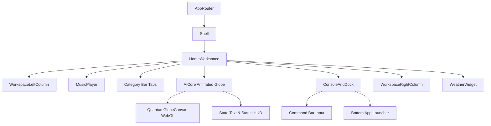

# JARVIS OS — Home Architecture Blueprint (`/home`)

## Overview
The Home page is the core command center of JARVIS OS. It is designed as a high-density, real-time executive dashboard featuring a 3-column responsive grid layout, an interactive 3D WebGL globe (`AICore`), system status monitors, live audio player, command console, and category-filtered workspace metrics.

## Component Hierarchy Map

## Detailed Component Specifications

### 1. `HomeWorkspace.tsx`
- **File Path**: [HomeWorkspace.tsx](file:///d:/jarvis/apps/web/src/widgets/workspace/ui/HomeWorkspace.tsx)
- **Grid Layout**: `grid-cols-[20%_1fr_22%] gap-5 overflow-hidden font-mono select-none`
- **State**: `activeCategory` (`ALL` | `WORK` | `SYSTEM` | `WEB` | `CODE` | `FINANCE` | `PERSONAL`).
- **Responsibility**: Houses and arranges all primary HUD components in exact proportions.

### 2. `AICore` Component Group
- **File Path**: [index.ts](file:///d:/jarvis/apps/web/src/entities/ai-core/index.ts)
- **Sub-component**: `QuantumGlobeCanvas` ([QuantumGlobeCanvas.tsx](file:///d:/jarvis/apps/web/src/shared/graphics/Globe/QuantumGlobeCanvas.tsx))
- **Visual Responsibilities**:
  - Renders interactive WebGL 3D Quantum Globe with particle fields and glowing rings.
  - Dynamically updates color spectrum and particle velocity based on `AssistantState`:
    - `IDLE`: Cyan/Blue glowing ambient rotation.
    - `LISTENING`: Bright Emerald Green pulse.
    - `THINKING`: Deep Purple/Violet high-speed rotation.
    - `SPEAKING`: Vibrant Neon Red/Orange audio frequency wave reactivity.
    - `ERROR`: Crimson Red rapid flicker.

### 3. `ConsoleAndDock.tsx`
- **File Path**: [ConsoleAndDock.tsx](file:///d:/jarvis/apps/web/src/widgets/workspace/ui/ConsoleAndDock.tsx)
- **Responsibilities**:
  - Top: High-visibility terminal input prompt for typing commands or AI questions.
  - Bottom: Quick-launch application dock with interactive glowing icon buttons for `/browser`, `/terminal`, `/memory`, `/files`, `/coding`, `/trading`, `/mission-control`, `/settings`.

### 4. `WorkspaceLeftColumn.tsx` & `MusicPlayer.tsx`
- **File Path**: [WorkspaceLeftColumn.tsx](file:///d:/jarvis/apps/web/src/widgets/workspace/ui/WorkspaceLeftColumn.tsx)
- **Responsibilities**: Displays real-time telemetry metrics (CPU load, Memory usage, Network traffic, System uptime) and ambient sound/music playback controls.

### 5. `WorkspaceRightColumn.tsx` & `WeatherWidget.tsx`
- **File Path**: [WorkspaceRightColumn.tsx](file:///d:/jarvis/apps/web/src/widgets/workspace/ui/WorkspaceRightColumn.tsx)
- **Responsibilities**: Category-filtered task list, active notifications, memory quick notes, and local weather telemetry.

## Frozen Layout Safeguards
> [!CAUTION]
> The Home page component placement, 3-column CSS grid proportions, typography, margins, padding, and globe animations are permanently frozen under the Golden Rule. No component may be relocated, replaced, or redesigned.
