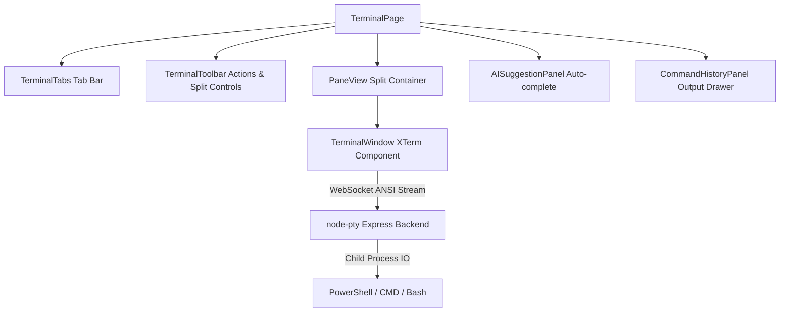

# JARVIS OS — Terminal Architecture Blueprint (`/terminal`)

## Overview
The Terminal workspace is a multi-tab, pane-splitting terminal interface connected via WebSockets to a Node-PTY backend service on Express.

## Component & Stream Topology

## Component Architecture

### 1. `TerminalPage.tsx`
- **Path**: [TerminalPage.tsx](file:///d:/jarvis/apps/web/src/widgets/terminal/ui/TerminalPage.tsx)
- Orchestrates multi-pane layout state, active shell environment (`powershell`, `cmd`, `wsl`), and drawer toggles for history and AI suggestions.

### 2. `TerminalWindow.tsx` & `PaneView.tsx`
- **Path**: [TerminalWindow.tsx](file:///d:/jarvis/apps/web/src/widgets/terminal/ui/TerminalWindow.tsx)
- Encapsulates interactive terminal output buffer, ANSI styling, terminal dimensions (rows/cols), resize listeners, and keybinding shortcuts.

### 3. `AISuggestionPanel.tsx`
- **Path**: [AISuggestionPanel.tsx](file:///d:/jarvis/apps/web/src/widgets/terminal/ui/AISuggestionPanel.tsx)
- Analyzes current command buffer or command output errors to provide instant AI auto-complete suggestions and command explanations.

### 4. `routes/terminal.js` (Backend PTY Service)
- **Path**: [terminal.js](file:///d:/jarvis/services/backend/src/routes/terminal.js)
- Manages `node-pty` processes, terminal resize events (`pty.resize`), write operations (`pty.write`), and bidirectional WebSocket data streams.
