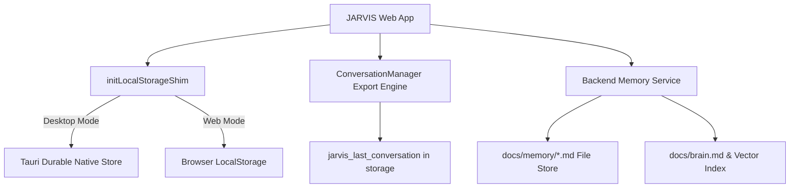

# JARVIS OS — Database & Storage Map (`docs/database-map.md`)

## Overview
JARVIS OS employs a hybrid multi-tier storage model combining ephemeral in-memory reactive stores, persistent client-side storage shims, Tauri durable OS stores, and local disk vector memory files.

## Storage Hierarchy

## Storage Technologies & Datastores

### 1. `initLocalStorageShim()`
- **Path**: [storageShim.ts](file:///d:/jarvis/apps/web/src/shared/utils/storageShim.ts)
- **Role**: Intercepts `localStorage` access on boot to mirror session reads/writes directly to Tauri's durable native store. Prevents data loss caused by Webview session wipes on app restart.

### 2. Conversation Store (`ConversationManager.ts`)
- **Path**: [ConversationManager.ts](file:///d:/jarvis/apps/web/src/shared/ai/ConversationManager.ts)
- **Key**: `jarvis_last_conversation`
- **Data Format**: Serialized JSON payload containing active message history, system prompt context, model metadata, and token counters.

### 3. Display & Theme Settings Store (`DisplaySettings.ts`)
- **Path**: [DisplaySettings.ts](file:///d:/jarvis/apps/web/src/shared/theme/DisplaySettings.ts)
- **Key**: `jarvis_display_settings`
- **Data Format**: JSON object containing glow intensities, dynamic colors, glass opacity levels, and font scaling parameters.

### 4. Custom Provider Store (`CustomProviderManager.ts`)
- **Path**: [CustomProviderManager.ts](file:///d:/jarvis/apps/web/src/shared/ai/CustomProviderManager.ts)
- **Key**: `jarvis_custom_providers`
- **Data Format**: Encrypted/base64 encoded JSON array storing custom LLM API endpoints, API keys, and model overrides.

### 5. Memory System File Store (`docs/memory/`)
- **Path**: `docs/memory/`
- **Role**: Markdown file system database storing modular project intelligence, UI rules, frozen component manifests, and subagent memory context (`home_memory.md`, `browser_memory.md`, `terminal_memory.md`, `mission_control_memory.md`, `voice_memory.md`, `vision_memory.md`, `automation_memory.md`, `system_memory.md`).

### 6. Master Architecture & Brain Index (`docs/brain.md`)
- **Path**: [brain.md](file:///d:/jarvis/docs/brain.md)
- **Role**: Primary codebase knowledge base and system context index consumed by the JARVIS AI Engine.
