# JARVIS OS — Master Dependency Graph (`docs/dependency-graph.md`)

## Overview
This document maps module-level imports, shared manager layers, backend services, and external provider dependencies across JARVIS OS.

## System Topology & Layers

```mermaid
graph TD
    subgraph UI_Layer["UI Workspace Layer (apps/web/src/widgets)"]
        HomeView[HomeWorkspace]
        BrowserView[BrowserWorkspace]
        TerminalView[TerminalWorkspace]
        MissionView[MissionControlPage]
        MemoryView[MemoryWorkspace]
    end

    subgraph Feature_Layer["Feature & Shared Logic (apps/web/src/shared)"]
        AIRouter[AIRouter]
        VoiceMgr[VoiceManager]
        AgentOrch[AgentOrchestrator]
        AudioFSM[AudioStateMachine]
        DisplaySet[displaySettings]
        ConvMgr[conversationManager]
        StorageShim[storageShim]
    end

    subgraph Backend_Layer["Backend Node Express Service (services/backend)"]
        Server[Express server.js]
        BrainSvc[BrainService]
        SearchSvc[SearchService]
        VoiceSvc[VoiceService]
        FileSvc[FileService]
        PTYService[terminal.js / node-pty]
    end

    subgraph Desktop_Layer["Tauri Shell (apps/desktop)"]
        TauriRust[Tauri Rust Native Core]
    end

    subgraph External_Providers["External & AI Providers"]
        Gemini[Gemini API]
        OpenAI[OpenAI API]
        Claude[Claude API]
        Ollama[Local Ollama]
        ElevenLabs[ElevenLabs Voice API]
    end

    HomeView --> AIRouter
    HomeView --> VoiceMgr
    HomeView --> AudioFSM
    HomeView --> DisplaySet

    BrowserView --> SearchSvc
    BrowserView --> AIRouter

    TerminalView --> PTYService
    TerminalView --> AIRouter

    MissionView --> AgentOrch
    AgentOrch --> BrainSvc

    AIRouter --> ProviderFactory
    ProviderFactory --> Gemini
    ProviderFactory --> OpenAI
    ProviderFactory --> Claude
    ProviderFactory --> Ollama

    VoiceMgr --> ElevenLabs
    VoiceMgr --> AudioFSM

    StorageShim --> TauriRust
    Server --> FileSvc
    Server --> BrainSvc
```

## Import & Module Boundaries
- `apps/web/src/app/main.tsx` imports:
  - `storageShim` ([storageShim.ts](file:///d:/jarvis/apps/web/src/shared/utils/storageShim.ts))
  - `bootstrap` ([bootstrap.ts](file:///d:/jarvis/apps/web/src/app/bootstrap.ts))
  - `AppRouter` ([app-router.tsx](file:///d:/jarvis/apps/web/src/app/providers/app-router.tsx))
- `AppRouter` imports workspace components from `widgets/workspace` and `widgets/mission-control`.
- Workspace components depend on `shared/ai`, `shared/audio`, `shared/agents`, `shared/theme`, and `shared/stores`.
